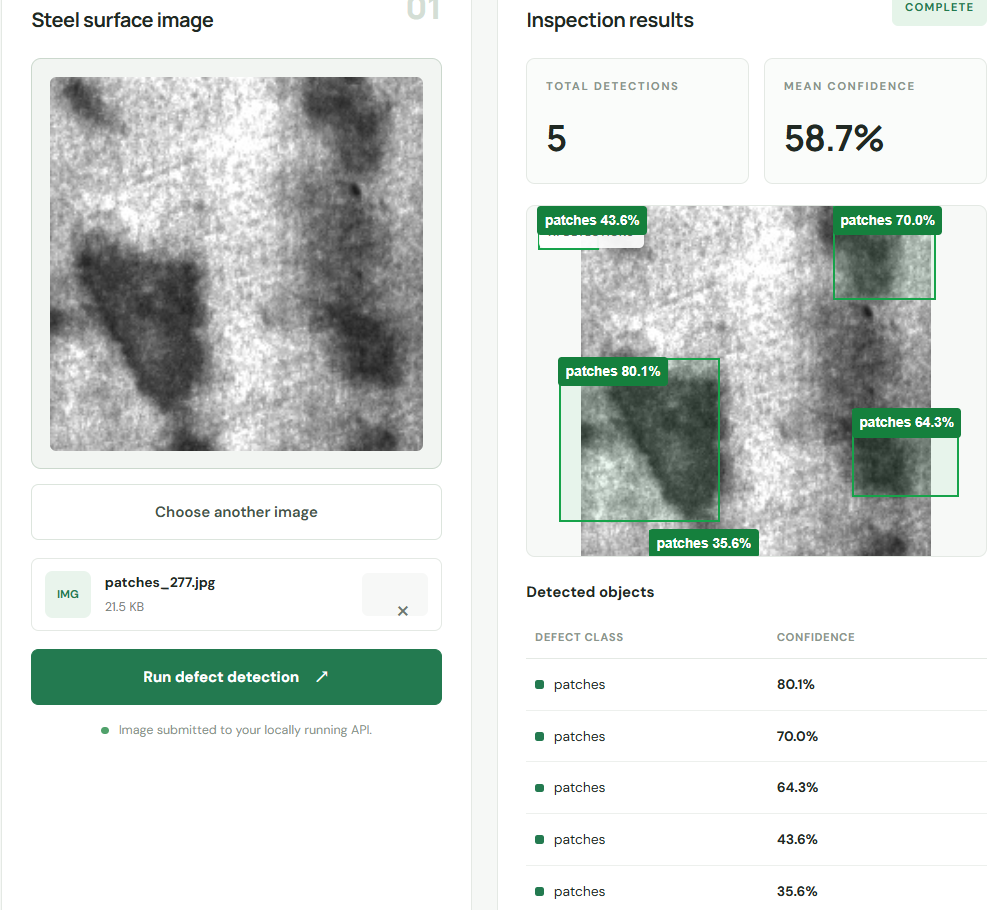

# SteelSight AI — Industrial Steel Surface Defect Detection

An AI-powered industrial surface inspection project that uses YOLO11n to detect and classify steel surface defects. The system combines a FastAPI backend with a React and Vite dashboard to display predictions, confidence scores, and bounding boxes.

## Project Overview

SteelSight AI explores how computer vision can assist steel surface inspection by identifying potential defects in uploaded images.

**Project type:** Computer Vision | Deep Learning | Full-Stack AI
## Project Demo

The dashboard allows users to upload steel surface images and view detected defects, confidence scores, and bounding boxes.

## Features

- Steel surface defect detection using YOLO11n.
- Six defect categories.
- Bounding boxes displayed on uploaded images.
- Predicted defect labels and confidence scores.
- FastAPI backend for model inference.
- React + Vite frontend dashboard.
- REST API for image prediction.
- Interactive API documentation through Swagger UI.

## Defect Categories

The model is designed to recognize six categories from the NEU steel surface defect dataset:

1. Crazing
2. Inclusion
3. Patches
4. Pitted Surface
5. Rolled-in Scale
6. Scratches

## Technology Stack

**AI and Computer Vision**

- Python
- Ultralytics YOLO11n
- PyTorch

**Backend**

- FastAPI
- Uvicorn

**Frontend**

- React
- Vite
- JavaScript
- HTML and CSS

**Development**

- Google Colab
- Visual Studio Code
- Git and GitHub

## System Workflow

1. The user uploads a steel surface image through the dashboard.
2. The frontend sends the image to the FastAPI backend.
3. YOLO11n processes the image.
4. The backend returns predicted defect classes, confidence scores, and bounding-box coordinates.
5. The frontend displays the predictions over the image.

## Model Training Configuration

| Parameter                    | Value                            |
| ---------------------------- | -------------------------------- |
| Model                        | YOLO11n                          |
| Dataset                      | NEU steel surface defect dataset |
| Number of classes            | 6                                |
| Training epochs              | 50                               |
| Batch size                   | 8                                |
| Reported training image size | 320                              |
| Training environment         | Google Colab                     |

The final trained checkpoint is named `best.pt`.

## Reported Evaluation Results

Two evaluation result sets were reported during development.

| Metric     | Reported run at image size 320 | Reported run at image size 640 |
| ---------- | ------------------------------ | ------------------------------ |
| Precision  | 70.00%                         | 35.25%                         |
| Recall     | 65.90%                         | 35.95%                         |
| mAP\@50    | 74.50%                         | 30.87%                         |
| mAP\@50–95 | 40.10%                         | 13.17%                         |

The image-size-640 evaluation output reported 360 images and 854 instances.

**Important:** These results are from separate reported runs. The exact checkpoints, validation split, and evaluation settings have not been verified as identical. They should not be interpreted as a controlled comparison between image sizes until both runs are reproduced under the same conditions.

### Metric Definitions

- **Precision:** The proportion of predicted detections that are correct.
- **Recall:** The proportion of actual objects detected by the model.
- **mAP\@50:** Mean average precision at an IoU threshold of 0.50.
- **mAP\@50–95:** Mean average precision averaged across IoU thresholds from 0.50 to 0.95.

## Project Structure
industrial-defect-detection/
├── main.py
├── requirements.txt
├── README.md
├── .gitignore
└── frontend/
    ├── package.json
    ├── package-lock.json
    └── src/
        ├── App.jsx
        ├── App.css
        ├── index.css
        └── main.jsx

This is a simplified representation of the project structure.

## Installation and Setup

### Prerequisites

- Python
- Node.js and npm
- Git
- Trained model weights (`best.pt`)

### 1. Clone the Repository

Replace the URL with your actual GitHub repository URL if it differs.

git clone https://github.com/siliverisrinithya-arch/SteelSight-AI.git
cd SteelSight-AI

### 2. Set Up the Backend

Create a virtual environment:

python -m venv .venv

On Windows PowerShell, activate it:

powershell
.\.venv\Scripts\Activate.ps1
Install the dependencies:

python -m pip install -r requirements.txt

Make sure the trained `best.pt` file is available at the model path expected by `main.py`.

### 3. Start the Backend

Run:
python -m uvicorn main:app --host 127.0.0.1 --port 8000

Backend API documentation:

http://127.0.0.1:8000/docs

Health endpoint:

http://127.0.0.1:8000/health

### 4. Start the Frontend

Open a second terminal:

powershell
cd frontend
npm install
npm run dev

Open the local URL printed by Vite. It is commonly `http://localhost:5173`, but the port may differ.

### 5. Run a Prediction

1. Open the dashboard.
2. Upload a steel surface image.
3. Submit it for prediction.
4. Review the detected defects, confidence scores, and bounding boxes.

The backend must remain running while you use the frontend.

## Model Weights

The trained model is stored in `best.pt`.

The model file is excluded from GitHub by default because it is a binary artifact. To run predictions, obtain the trained weights separately and place them at the path expected by the backend.

If the weights are published separately, add a working download link here.

## Limitations

- Performance depends on image quality and similarity to the training data.
- The model can miss defects or generate false detections.
- Confidence scores do not guarantee that a prediction is correct.
- The reported evaluation results need verification under consistent settings.
- This project is a portfolio prototype, not a validated industrial inspection product.

It should not be used as the sole basis for safety-critical or production quality-control decisions.

## Future Improvements

- Evaluate a final checkpoint on a fixed validation dataset.
- Report per-class precision, recall, and average precision.
- Add a confusion matrix and error analysis.
- Measure inference latency and resource usage.
- Add downloadable inspection reports and prediction history.
- Test with representative real-world factory images.
- Explore deployment on edge devices.

